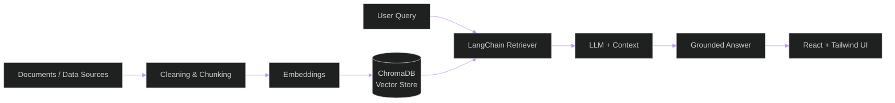

 

 

## Executive Summary

I build AI products end to end: from the data layer and retrieval pipeline to the interface people actually use.
My work sits at the intersection of **data analytics**, **LLM application development**, and **modern frontend engineering**.

| | |
|---|---|
| **Focus** | Retrieval-Augmented Generation (RAG), conversational AI, data analysis & visualization |
| **Core stack** | Python, LangChain, ChromaDB, Pandas |
| **Interface layer** | React, Tailwind CSS |
| **Approach** | Measurable results, clean architecture, readable code |
| **Currently** | Building and refining RAG chatbots over custom knowledge bases |

 

## How I Build RAG Systems

 

## Technical Arsenal

<table>
<tr>
<td width="25%"><b>AI &amp; LLM</b></td>
<td>

</td>
</tr>
<tr>
<td><b>Data Analytics</b></td>
<td>

</td>
</tr>
<tr>
<td><b>Frontend</b></td>
<td>

</td>
</tr>
<tr>
<td><b>Tools &amp; Workflow</b></td>
<td>

</td>
</tr>
</table>

 

## Featured Projects

<!--
  Replace REPO_NAME_1 / REPO_NAME_2 / REPO_NAME_3 with your real repository names.
  The cards update automatically with description and language.
-->

 

 

## Analytics

  

 

  

 

## Let's Connect

Open to collaboration on RAG systems, AI chatbots, data analytics projects, and frontend work.

  

