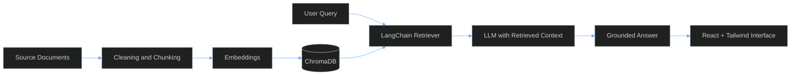

# Shahansha Khan

### AI Developer · Data Analyst · Frontend Engineer

I build retrieval-based AI systems, the data pipelines behind them, and the interfaces people use to work with them.

 

 

## About

I work across the full path from raw data to a usable AI product: cleaning and analysing data, building RAG pipelines with LangChain and ChromaDB, and shipping responsive interfaces in React and Tailwind CSS.

I care about three things in everything I build: **accuracy** (answers grounded in source data), **clarity** (code and dashboards others can read), and **usability** (interfaces that need no explanation).

 

## What I Do

| Area | What it covers |
|---|---|
| **AI Engineering** | RAG chatbots, document ingestion and chunking, embeddings, vector search with ChromaDB, LLM orchestration with LangChain |
| **Data Analytics** | Data cleaning, exploratory analysis, KPI reporting and visualisation with Python and Pandas |
| **Frontend Development** | Responsive, accessible UIs with React and Tailwind CSS for AI and data products |

 

## Technical Skills

| | |
|---|---|
| **AI / LLM** |  &nbsp; LangChain &nbsp;·&nbsp; ChromaDB &nbsp;·&nbsp; RAG &nbsp;·&nbsp; Prompt Engineering |
| **Data** |  |
| **Frontend** |  |
| **Tools** |  |

 

## System Design: RAG Pipeline

 

## Contact

I'm open to roles and projects in **AI development, data analytics, and frontend engineering**.

- **Email:** [shahanshaali6401@gmail.com](mailto:shahanshaali6401@gmail.com)
- **LinkedIn:** [linkedin.com/in/shahansha-ali](https://www.linkedin.com/in/shahansha-ali)
- **GitHub:** [github.com/shahansha01](https://github.com/shahansha01)
